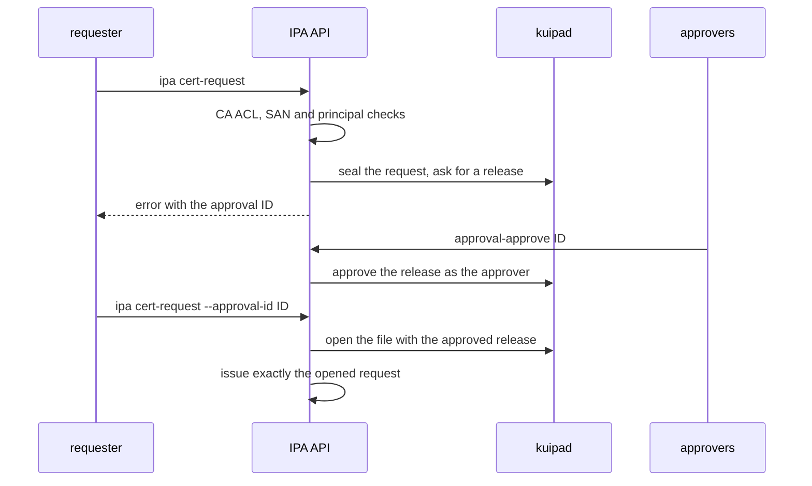

# M-of-N approval of certificate and vault operations with kuipa

This document describes how an IPA operation can be made to wait for the approval of `m` of a
named set of people before it runs. The approvals are enforced by
[kuipa](https://github.com/abbra/kuipa), a separate project that provides kuipad and the `kuipa`
client; IPA only decides which operations are gated and carries the request. Certificate issuance
is the first gated operation; certificate revocation and vault retrieval use the same mechanism.

## Overview

Issuing a certificate from a sensitive profile, revoking a certificate, or retrieving a vault is
today a decision of one account: whoever passes the CA ACL, holds the permission, or owns the vault.
A compromised or careless account is enough.

kuipa seals can require `m` approvals from a named set before a server releases its share of a file
(kuipa `docs/DESIGN-approvals.md`). An IPA operation is not a file release, so IPA turns it into
one: the request is sealed to an *approvals seal*, kuipad is asked for a release of that file, the
approvers decide on the release, and IPA runs the operation only after opening the file with the
approved release. IPA runs exactly what was sealed, so what the approvers saw is what happens.

What kuipa provides: counting the approvals, the approval window, the number of uses, refusing the
requester's own approval, and a transparency log of the decisions. What IPA provides: the link
between an entry (a profile, a CA, a vault) and its seal, the store of pending requests, and the
`approval-*` commands.

## Use Cases

### UC1: Two administrators agree before a certificate is issued

A PKI team wants no single administrator to obtain a service certificate from a profile that
authorizes high-value hosts. Requesters ask as usual; two of the team's approvers must agree before
the CA signs.

### UC2: Revoking a certificate takes two people

Revocation is the destructive half of PKI operations. An approvals seal on a CA makes every
`cert-revoke` for that CA wait for two approvers; the approval covers that revocation (serial and
reason) and nothing else.

### UC3: Retrieving a vault needs a second pair of eyes

A vault holds a shared secret. Retrieving it asks the vault's approvers; the requester repeats the
retrieval with the approval ID.

### UC4: An approver from a trusted Active Directory domain

An AD user with an ID override in the default trust view is a user of the IPA directory. Approvers
of the PKI team may include such users, named `user@AD.REALM` or through an IPA group that holds
their ID override.

## How to Use

### Gating certificate issuance (UC1)

1. With kuipa, create a seal that opens with a Kerberos ticket alone (no device factor), whose
   members include every requester (users or a group), and whose policy has `approvals` (`m`, the
   approvers, a window, `uses` 1).
2. Tie a profile to it. The command checks the seal: enabled, `approvals` set, a ticket factor, no
   device or passkey factor, no offline sessions. The link is the `ipaKUApprovalSeal` attribute of
   the profile entry, in the auxiliary class `ipaKUApprovalGated`, which any entry whose use needs
   approval may carry:

   ```console
   # ipa certprofile-add-approval caIPAserviceCert --seal admin/certs
   ```

   `ipa certprofile-del-approval` removes it.
3. A requester runs `ipa cert-request` as usual. For such a profile nothing is issued; the error
   carries an approval ID.
4. Approvers list and inspect requests, then decide:

   ```console
   # ipa approval-find --kind=cert-request
   # ipa approval-show ID
   # ipa approval-approve ID      (or approval-deny)
   ```

5. The requester repeats the same `ipa cert-request` with `--approval-id ID`.

### Gating revocation (UC2)

```console
# ipa ca-add-revoke-approval ipa --seal admin/certs
# ipa cert-revoke SERIAL                      (prints an approval ID)
# ipa approval-approve ID                     (as each approver)
# ipa cert-revoke SERIAL --approval-id ID
```

`ipa ca-del-revoke-approval` removes the gate. `cert-remove-hold` is not gated.

### Gating vault retrieval (UC3)

```console
# ipa vault-add-approval NAME [--user|--service|--shared] --seal OWNER/NAME
# ipa vault-retrieve NAME ...                 (prints an approval ID)
# ipa vault-retrieve NAME ... --approval-id ID
```

`ipa vault-del-approval` removes the gate.

### Approvers from a trusted domain (UC4)

```console
# ipa idoverrideuser-add 'Default Trust View' user@ad.example
# ipa group-add-member pki-approvers --idoverrideusers user@ad.example
```

Such a user can be an approver or a requester, and a seal administrator through a group in a
role. They own seals only where the realm's `trusted_owners` limit allows it
(`ipa sealconfig-mod --trusted-owners-allow`). A trusted realm's user with no override is refused.

## Design

### Request flow



### Steps

- `cert_request` (`ipaserver/plugins/cert.py`) runs every existing check first (CA ACL, SAN,
  principal rules), then asks `certapproval.approval_seal(profile)`. Without a seal nothing
  changes.
- First call: `create_approval` hands the canonical request `{requester, profile, ca, principal,
  csr}` to the generic store (`approval.create_request`), which seals it to the seal, runs `kuipa
  seal request` and stores an `ipaKUApprovalRequest` entry. The entry has the common parts as
  attributes (kind, requester, seal, release, sealed file) and the workflow's own part as the JSON
  `ipaKUApprovalData`, exactly what was sealed. Other workflows reuse the class with their own
  kind and data. All kuipa calls run with the caller's delegated credentials
  (`seal.kuipa_session`), so kuipad sees the real requester and never counts their own approval.
- Repeat call: `redeem_approval` compares the entry's kind, seal, requester and data, and the
  opened plaintext, with the arguments of this call, and opens the file with `kuipa seal open
  --request`. kuipad enforces approvals, the window, `uses` and that the opener is the requester.
  IPA then issues exactly the opened request.
- Any other workflow calls `approval.require_approval(kind, seal, document, approval_id, reason)`:
  with no approval ID it makes a request and ends with an error naming the ID; with one it redeems
  it.

### Directory state

| Object | Purpose |
| --- | --- |
| `ipaKUApprovalRequest` (structural) | A pending request: `cn` (the ID), `ipaKUApprovalKind` (`cert-request`, `cert-revoke`, `vault-retrieve`), `ipaKUApprovalRequester`, `ipaKUApprovalSeal`, `ipaKUApprovalRelease`, `ipaKUApprovalSealed`, `ipaKUApprovalData` |
| `ipaKUApprovalGated` (auxiliary) | The link: `ipaKUApprovalSeal`, on a certificate profile, a CA or a vault |
| `cn=approvals,cn=kuipa,cn=etc,$SUFFIX` | Container of the pending requests |

The schema is in `install/share/schema.d/74-kuipa.ldif` and the container in
`install/updates/74-kuipa.update`. The link attribute is added to the target attributes of the
existing permissions *System: Modify Certificate Profile*, *System: Read Certificate Profiles*,
*System: Modify CA*, *System: Read CAs*, *System: Modify Vaults* and *System: Read Vaults*, so
whoever may modify the entry may gate it.

### Access control

Anyone may add and read approval entries (an ACI on the container). An entry is therefore not
trusted: the seal comes from the profile's (or CA's, or vault's) current configuration, and the
entry, the sealed file and the issuing call must agree. A forged entry is harmless, since the
workflow re-opens the sealed request and compares it with the entry and with what it is about to
do; an entry whose data differs from its sealed file fails at issuance and never issues.

Approving is not an IPA permission: `approval-approve` and `approval-deny` call kuipad with the
approver's own delegated credentials, and kuipad decides from the seal's policy whether that
principal is an approver. Revocation of a seal and the limits of users' seals are administered
with the `KUIPA Seal Administrators` privilege (see the kuipa enrollment design).

### What stays out

- ACME, direct Dogtag/RA-agent access and `request certificate ignore caacl` holders are not
  gated; do not offer an approval profile to ACME.
- A vault's owners can write its attributes (the vault ACIs), so an owner can ungate their own
  vault by LDAP: the gate protects an owner from a single account acting alone only when the seal
  is set by someone else, or the owner is trusted not to remove it. Only asymmetric and symmetric
  vaults keep the data secret from the KRA's administrators too.
- One issuance is enforced by kuipa's `uses`, which can be exceeded by releases on other servers
  within one replication delay.
- Pending entries are not purged; kuipa's window ends their usefulness.
- No notifications; `ipa approval-find` is the interface.
- Approvers see the request's fields in `approval-show` (the data is what was sealed, checked at
  issuance), but kuipa approves a release request, not the document.

### Compatibility

Older servers have neither the schema nor the commands. The commands need the kuipa client and
server packages on the server that runs them. The commands are part of the kuipa integration, which raises
the API minor version once (`VERSION.m4`).

## Implementation

| Component | Where |
| --- | --- |
| Generic store, seal checks, gate helpers, `approval-find/show/approve/deny` | `ipaserver/plugins/approval.py` |
| Certificate issuance and revocation gates, `certprofile-add/del-approval`, `ca-add/del-revoke-approval` | `ipaserver/plugins/certapproval.py`, `cert.py`, `certprofile.py`, `ca.py` |
| Vault gate, `vault-add/del-approval`, `--approval-id` | `ipaserver/plugins/vault.py`, `ipaclient/plugins/vault.py` |
| kuipa calls as the caller | `ipaserver/plugins/seal.py` (`kuipa_session`) |

### Dependencies

No new package: the `kuipa` client and kuipad are already part of the kuipa integration.

### Backup and Restore

Pending requests and the link attributes are LDAP data and travel with the LDAP backup; nothing
new is added to the file list. Seals are covered by the kuipa backup design.

## Feature Management

### UI

None. The commands are CLI and API only.

### CLI

| Command | Options |
| --- | --- |
| `certprofile-add-approval`, `certprofile-del-approval` | `PROFILE`, `--seal OWNER/NAME` |
| `ca-add-revoke-approval`, `ca-del-revoke-approval` | `CA`, `--seal OWNER/NAME` |
| `vault-add-approval`, `vault-del-approval` | `NAME`, `--user`/`--service`/`--shared`, `--seal OWNER/NAME` |
| `approval-find`, `approval-show` | `--kind`, `--requester`, `--seal`, `--all`, `--raw` |
| `approval-approve`, `approval-deny` | `ID` |
| `cert-request`, `cert-revoke`, `vault-retrieve` | `--approval-id ID` |

### Configuration

None. The seal and its approvers are kuipa configuration; an operation is gated while its link
attribute is set.

## Upgrade

The schema file and the update file create the attributes, the object classes and the container; a
server upgrade applies them, and the target attributes of the six permissions are updated with the
installed ACI definitions. Servers must be upgraded together before the commands are used, since
the entries are replicated.

## Test plan

Unit (`ipatests/test_ipaserver/test_approval.py`, `test_certapproval.py`):

- only a ticket-only approvals seal gates a profile;
- a gated workflow without an approval makes a request, and with one redeems it;
- a matching approved request is redeemed; a forged entry is refused before opening; a sealed
  request that differs is refused; an unapproved request is refused;
- revocation is gated only by a CA that has a seal.

Integration (`ipatests/test_integration/test_kuipa_cert_approval.py`):

- `TestKuipaCertApproval`: issuance needs two approvals; revocation needs two approvals, and an
  approval does not carry to another revocation reason.
- `TestKuipaCertApprovalTrustedUser`: issuance with an approver from a Samba AD trust; a trusted
  user as member, manager and depositor of other seals; an unknown trusted-realm user is refused.

Vault retrieval has no automated test yet; it was not run against a KRA (the test realm has none).

## Troubleshooting and debugging

- The commands call `kuipa` as the authenticated caller with delegated credentials, so a failure
  such as "kuipa delegated credentials or local anchor unavailable" means the API call arrived
  without a forwardable ticket, or the server has no kuipad anchor (`/etc/ipa/ku-anchors`).
- A refused request names the reason: the seal is missing or unreadable, disabled, requires no
  approvals, lacks a ticket factor, needs a device or passkey, or allows offline sessions.
- `ipa approval-find --kind=KIND` and `ipa approval-show ID --all` show the pending entries; the
  entries live under `cn=approvals,cn=kuipa,cn=etc`. `ipa approval-show ID --all --raw` shows the
  stored attributes.
- kuipad logs approvals, denials and releases to the journal (`journalctl -u kuipad`) and records
  them in its transparency log (`kuipa tlog watch SEAL` on a host).
- To see what a seal needs, run `kuipa seal show OWNER/NAME` as a member.
