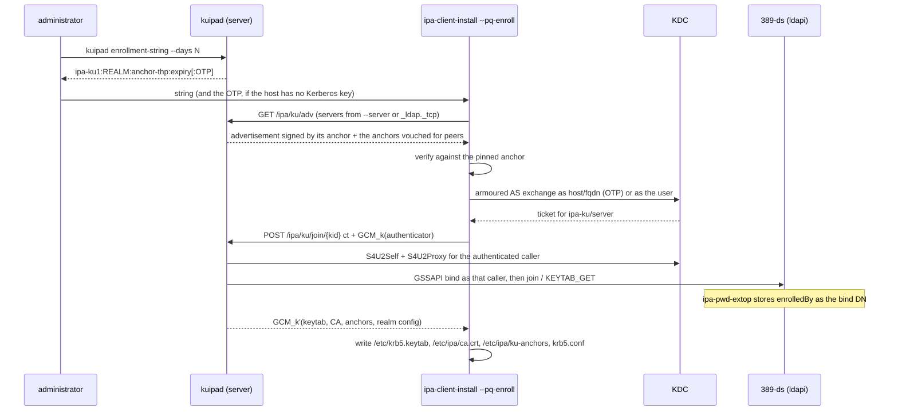

# Post-quantum enrollment: `ipa-client-install` through kuipa

## Overview

`ipa-client-install` enrolls a host in two steps: authenticate
(`kinit_password`, `kinit_keytab` or `kinit_pkinit` — `ipaclient/install/client.py:43`,
call sites `:3035`, `:3046`, `:3073`), then run `/usr/sbin/ipa-join`
(`ipaclient/install/client.py:2990`, `ipaplatform/base/paths.py:277`). With a host
password `ipa-join` binds to LDAP as the host itself and sends the join extended
operation (`JOIN_OID 2.16.840.1.113730.3.8.10.3`, `client/ipa-join.c:54`); with a
Kerberos ticket it calls the `host_add` API over `https://<server>/ipa/json`
(`client/ipa-join.c:695`). The `ipa-enrollment` plugin answers the extended operation by
adding `krbPrincipalName` and `krbPrincipalAux` to the host entry and returning the
principal name (`daemons/ipa-slapi-plugins/ipa-enrollment/ipa_enrollment.c:56`,
`:280-284`); `ipa-join` then forks `/usr/sbin/ipa-getkeytab` to fetch the keys
(`client/ipa-join.c:1189-1231`). `ipa-getkeytab` uses the LDAP extended operations
`KEYTAB_SET_OID` (`2.16.840.1.113730.3.8.10.1`) and `KEYTAB_GET_OID`
(`2.16.840.1.113730.3.8.10.5`) — `util/ipa_krb5.h:97`, `:99`, called at
`client/ipa-getkeytab.c:538`, `:702` — which the `ipa-pwd-extop` plugin answers
(`daemons/ipa-slapi-plugins/ipa-pwd-extop/ipa_pwd_extop.c:69`, `:1784`) from keys stored
in `krbPrincipalKey` (`daemons/ipa-kdb/ipa_kdb_principals.c:2639`).

kuipa (`https://github.com/abbra/kuipa`) is a Rust implementation of the same exchange
in which the secrets travel inside a post-quantum hybrid envelope — ML-KEM (FIPS 203)
encapsulation for the secret, ML-DSA (FIPS 204) signatures for the realm's claims,
AES-256-GCM for the payload — instead of plaintext LDAP extended operations and JSON-RPC.
It changes how the keytab *travels* and is *stored*, not how the keys are made: the KDC,
`krbPrincipalKey`, and the keytab extended operations are untouched
(`kuipa` `docs/DESIGN.md:24-29`). PKINIT itself, FAST armour and ML-DSA host
certificates are explicitly out of scope (`docs/DESIGN.md:36`).

What the join exchange buys, per `docs/DESIGN.md` §5.1:

* **Post-quantum secrecy.** The keytab arrives under `k' = HKDF(ss ‖ ss_e ‖ kb, …)`,
  where `ss` is the ML-KEM shared secret of a key whose server a pinned anchor vouched
  for, and `ss_e` comes from an ephemeral key pair that existed only in client memory. A
  recording plus a later compromise of the server's long-term key does not reveal it.
* **Two independent authentication roots.** `ss` authenticates the server through the
  anchor chain; `kb`, derived with RFC 4401 `GSS_Pseudo_random` from the session key of a
  Kerberos service ticket for `ipa-ku/<server>`, authenticates it through the realm's
  Kerberos keys. Both must fail for a host to be fooled, i.e. a stolen anchor *and* a
  stolen server key.
* **No plaintext host secret on the wire.** The join request body — the OTP, or a Kerberos
  V5 initial token bound to this exchange by channel binding — is itself encrypted under
  `k`.
* **No pre-enrollment Kerberos configuration.** Password and OTP joins run the AS exchange
  in-process, against a private temporary `krb5.conf` built from the verified
  advertisement, so `kinit_password`/`kinit_keytab`/`kinit_pkinit` are not needed on a
  host that has no realm configuration yet (`docs/DESIGN.md:1096-1106`, `:1159-1162`).

Enrollment stays authorized by the same directory ACIs, and an OTP is still the default
authenticator: what changes is that the OTP is checked either by an armoured AS exchange
as `host/<fqdn>` (`docs/DESIGN.md:1089`) or, with `--ldap-otp`, by the same simple bind
`ipa-join` uses (`docs/DESIGN.md:1130-1134`). A host enrolled today is not protected
against a future quantum adversary — its keytab crossed the network in plaintext — and
kuipa does not claim otherwise: after enrollment the host authenticates with that keytab
exactly as before.

kuipa is a separate upstream (version 0.1.0) with its own RPM set — `kuipa` (the client
tools), `kuipa-server` (`/usr/libexec/kuipad`),
`tang-pqc`, `clevis-pin-tang-pqc` (`contrib/packages/kuipa.spec.in:50`, `:157`, `:183`,
`:203`) — currently published only in the COPR
[abbra/pqc](https://copr.fedorainfracloud.org/coprs/abbra/pqc/) and its dependency COPR
[abbra/rust-deps](https://copr.fedorainfracloud.org/coprs/abbra/rust-deps/) for Fedora;
see [Package availability](#package-availability). The FreeIPA server side is already in
the tree: `KuipadInstance` is run by `ipa-server-install`, `ipa-replica-install` and
`ipa-server-upgrade` (`ipaserver/install/kuipadinstance.py`,
`ipaserver/install/server/install.py:1053`, `replicainstall.py:1461`,
`upgrade.py:1916`). What this design adds is the client side: `kuipa enroll` becomes the
backend of `ipa-client-install`'s join, and the `--pq-enroll`, `--pq-bundle` and
`--no-pq` options select it.

## Use Cases

### 1. OTP enrollment (the default path)

The administrator prepares the host and an enrollment string:

```console
$ ipa host-add --random client12.ipa.test
  ---------------------------
  Added host "client12.ipa.test"
  ---------------------------
    Random password: 1Fzop138ftt6TCcfpMs56Ql
$ ssh master.ipa.test /usr/libexec/kuipad enrollment-string --days 1
ipa-ku1:EXAMPLE.TEST:dgt-VqrSdFC64H8R98ehg3kLJ8FzijPp84MmUJHHKMk:1793575335
```

`host-add --random` produces the OTP and stores it as the host's `userPassword`
(`ipaserver/plugins/host.py:549`, `:785`). The enrollment string carries no secret: realm,
the issuing server's anchor thumbprint, an expiry (`kuipa`
`crates/kuipad/src/main.rs:288-308`, format `crates/kuipa-enroll/src/enrollment.rs:4-5`).
An optional fifth field is the OTP itself (`EnrollmentString::new(..., secret)`); with it,
the string alone is enough for the host to enroll.

On the host:

```console
# ipa-client-install --domain ipa.test --server replica1.ipa.test --pq-enroll
```

Once `host-add --random` also sets the host's Kerberos key (gap 1 below), `kuipa enroll`
discovers the deployment (`_ldap._tcp.<domain>`, or the `--server` list —
`crates/kuipa-tools/src/dns.rs:341-369`), verifies each server's advertisement against the
anchor in the string, runs an armoured AS exchange as `host/client12.ipa.test@EXAMPLE.TEST`
keyed by the OTP, and rekeys as that host (`crates/kuipa-tools/src/flows.rs:851-855`), which
is what puts the real keys into the directory and the keytab. Today the same result is
reached with `--ldap-otp`, which checks the OTP by LDAP simple bind instead
(see [Demonstrate it now](#demonstrate-it-now)). Either way the daemon logs one line per
accepted exchange (`crates/kuipad/src/http.rs:551`, `:572`) — `Join` for the join endpoint,
`Rekey` for the rekey one:

```
Oct 31 22:23:16 replica1 kuipad[1234]: kuipad: Join client12.ipa.test: ok
```

What the host ends up with (observed in the live CI container, an `--ldap-otp` join):

| Path | Content |
| --- | --- |
| `/etc/krb5.keytab` | `host/client12.ipa.test@EXAMPLE.TEST`, 4 keys, kvno 1 |
| `/etc/ipa/ku-anchors` | the realm's anchors: one thumbprint per line with its expiry, plus an `epoch <seq> <hash>` watermark line (`kuipa` `crates/kuipa-tools/src/paths.rs:84-88`, `:888-936`) |
| `/etc/ipa/ca.crt` | the IPA CA chain from the verified response |
| `/var/lib/ipa-client/ku/krb5.conf`, `pkinit-anchors.pem` | realm Kerberos configuration and PKINIT anchors |
| `/var/lib/ipa-client/ku/state.json`, `realm.json`, `recipient.jwk` | client state, world-readable public state, recipient key for seals |

The four enctypes are exactly what `ipa-getkeytab` produces today: the client proposes
aes256-cts-hmac-sha384-192, aes128-cts-hmac-sha256-128, aes256-cts-hmac-sha1-96,
aes128-cts-hmac-sha1-96 and the KDC keeps those the realm allows
(`kuipa` `docs/DESIGN.md:1141-1142`). `kadmin.local -q 'getprinc host/client12.ipa.test'`
on the master shows the same four enctypes at kvno 1, as `ipa-getkeytab` would.
What the directory ends up recording depends on which endpoint the first contact uses, and
this was measured on the live deployment rather than inferred:

* `ipa-enrollment`'s `JOIN_OID` handler adds `krbPrincipalName`, `krbPrincipalAux` and
  `krbCanonicalName` only (`daemons/ipa-slapi-plugins/ipa-enrollment/ipa_enrollment.c:280-284`);
  it never touches `enrolledBy`. `enrolledBy` is written by `ipa-pwd-extop` whenever it stores
  new keys: `remove_user_password` adds it as the **bind DN of the connection that ran the
  keytab operation**, and only when the entry has none
  (`daemons/ipa-slapi-plugins/ipa-pwd-extop/ipa_pwd_extop.c:853-885`, called from
  `store_new_keys` at `:910`, reached from `KEYTAB_SET` at `:1358` and from `KEYTAB_GET` at
  `:1764`).
* So the value says *which identity ran the keytab operation*, and the paths differ.
  `--ldap-otp` binds as the host with the OTP (`kuipa` `crates/kuipad/src/directory.rs:613-626`),
  and `rekey_with_gss` — what the armoured-AS OTP path sends (`crates/kuipa-tools/src/flows.rs:851-855`,
  `rekey_with_gss` requires caller == host, `directory.rs:641-652`) — also runs `KEYTAB_GET` on a
  connection bound as the host (`:653-654`). Both therefore record the host as its own enroller:
  a fresh `kuipa enroll --ldap-otp` of a host with no prior `enrolledBy` produced
  `enrolledBy: fqdn=client99.ipa.test,cn=computers,cn=accounts,…`, and deleting the attribute
  then running `kuipa rotate-keys` wrote the same self-reference back. That is exactly what
  `ipa-join` with a host password records today.
* The user-authorized path is the one with audit value: `join_with_gss` binds as the
  impersonated caller (`directory.rs:628-638`), so `enrolledBy` is that user — and it is the
  only value the CLI presents readably: `enrolledby` is a member of users
  (`ipaserver/plugins/host.py:317`), so `ipa host-show --all` turns it into
  `enrolledby_user: admin`, while a host's own or a daemon's DN is dropped unless `--raw` is
  added (`client1.ipa.test` and `demo1.ipa.test` show nothing without it).
* Nothing on the OTP paths records **who issued the OTP**. Closing that is the gap 7 below;
  kuipa's tracker phrases it as the first-contact rekey setting `enrolledBy` "as the join
  extended operation does" (`TODO.md:224-226`), and this design treats the audit of the
  authorizer, not the presence of the attribute, as the requirement.

### 2. Enrollment authorized by a user's credential

```console
# ipa-client-install --domain ipa.test --server master.ipa.test \
      --pq-enroll --principal admin
```

`kuipa` runs the AS exchange in process — the password, then whatever else the KDC asks
for, each answer inside the FAST armour (`docs/DESIGN.md:1107-1122`) — and joins with a
Kerberos authenticator for `ipa-ku/<server>`, which the server uses through
S4U2Self/S4U2Proxy to act as that user at LDAP (`docs/DESIGN.md:1080`). The existing ACIs
decide, applied to the caller's identity (`docs/DESIGN.md:1135-1138`), so
`Host Enrollment` privilege works exactly as it does for `ipa-join`, and `enrolledBy`
records the user as it does today.

For a realm whose users authenticate with a passkey or an external IdP there is no password
to build the FAST challenge with, so the installer takes the other route kuipa documents
(`docs/DESIGN.md:1147-1162`):

```console
# kuipa realm-info --domain ipa.test --krb5-dir /run/ipa/ku-tmp
# KRB5_CONFIG=/run/ipa/ku-tmp/krb5.conf KRB5CCNAME=/run/ipa/ku-tmp/cc kinit -n
# KRB5_CONFIG=… KRB5CCNAME=… kinit -T /run/ipa/ku-tmp/cc/admin admin
# kuipa enroll --use-ccache
```

`ipa-client-install --pq-enroll --principal admin` performs those three steps itself; the
commands are shown to make the sequence visible.

### 3. Offline enrollment

A host that will not reach the network during installation — an image build, a datacentre
provisioning run. On the host, before the image is frozen:

```console
# kuipa prepare
machine key thumbprint   5q1X…
its public key           {"kty":"ML-DSA",…}   (in /var/lib/ipa-client/ku/recipient.pub.jwk)
the IPA administrator stages it with
  ipa host-add client13.ipa.test --pq-stage --pq-recipient=/path/recipient.pub.jwk
```

(`crates/kuipa-tools/src/flows.rs:966-968` prints that command; `--pq-stage` and
`--pq-recipient` are planned FreeIPA options, see [Feature Management](#feature-management).)
The daemon serves `POST /ipa/ku/stage/{kid}` today (`kuipa` `crates/kuipad/src/http.rs:114`)
and stages the recipient there, but nothing in FreeIPA reaches it: no framework command and no
`kuipa` subcommand posts to it (`crates/kuipa-tools/src/flows.rs` has no stage call) — gap 2
below. Once `--pq-stage` exists, the server stages the keys there and the bundle is signed and
sealed. On the host at install time:

```console
# ipa-client-install --domain ipa.test --pq-enroll --pq-bundle staged-bundle.json
```

`kuipa enroll --bundle` enrolls from the bundle with no network access and leaves the
deferred steps in `/var/lib/ipa-client/ku/pending.json`; `kuipa complete` finishes them at
first contact, replacing the staged keys with keys from the realm's KDC
(`crates/kuipa-tools/src/bin/kuipa.rs:231-232`, `crates/kuipa-tools/src/flows.rs:977`).

### 4. No post-quantum enrollment

`--no-pq` keeps today's code path: `kinit`, `/usr/sbin/ipa-join`, `/usr/sbin/ipa-getkeytab`.
It is the default until the client-side options land, and the escape hatch for a client
without a `kuipa` package — an older release, a container image, an architecture the COPR
does not build.

## How to Use

Two states exist in this design, and the steps differ, so they are separated explicitly.

**Already in the tree (server side).** `ipa-server-install`, `ipa-replica-install` and
`ipa-server-upgrade` run `KuipadInstance`, which installs the daemon's side of kuipa on
every server (the `cn=kuipa` containers and ACIs, `/etc/ipa/kuipad.json`, `/var/lib/ipa/ku`
with the server's realm keys, the `ipa-ku/<server>` service and keytab, the s4u2proxy
delegation, `kuipad.socket` + `kuipad.service`, and the httpd `/ipa/ku/` proxy). A realm
installed with `kuipa-server` present is therefore ready to answer post-quantum joins today.

**Planned (client side).** `ipa-client-install` does not yet call `kuipa enroll`: no
`--pq-enroll`, `--pq-bundle` or `--no-pq` exists in `ipaclient/install/client.py`, and
`kuipa`'s own tracker lists them as the FreeIPA client item (`kuipa` `TODO.md:229-233`).
Until then a host enrolls by running `kuipa` directly; those commands are the ones this
design moves into the installer.

### Demonstrate it now

On a realm installed with `kuipa-server` present:
```console
# 1. prepare the host record and an enrollment string on a server
$ ipa host-add --random client1.ipa.test
    Random password: 1Fzop138ftt6TCcfpMs56Ql
$ ssh master1.ipa.test /usr/libexec/kuipad enrollment-string --days 1
ipa-ku1:EXAMPLE.TEST:dgt-VqrSdFC64H8R98ehg3kLJ8FzijPp84MmUJHHKMk:1793575335

# 2. on the client: write the string with the OTP appended as a fifth field
#    ipa-ku1:EXAMPLE.TEST:dgt-…:1793575335:1Fzop138ftt6TCcfpMs56Ql  ->  /tmp/kuipa.string

# 3. enroll
# kuipa enroll --server master1.ipa.test --enrollment-file /tmp/kuipa.string \
#              --hostname client1.ipa.test --ldap-otp

# 4. check
# kuipa status; klist -ke /etc/krb5.keytab
$ ipa host-show client1.ipa.test --all --raw   # Keytab: True, enrolledBy = the host's own DN
$ journalctl -u kuipad            # "kuipad: Join client1.ipa.test: ok"
```

Step 3 uses `--ldap-otp` because `host-add --random` today sets only `userPassword`; with
no Kerberos key on the host, the OTP has to be checked in LDAP, which is the same simple
bind `ipa-join` performs (`kuipa` `docs/DESIGN.md:1130-1134`). Closing that gap is a
server-side item in this design: `host-add --random` would also set the host's Kerberos key
with `krbPrincipalExpiration` at the string's expiry, so the ordinary armoured-AS path
becomes available for `--random` hosts (`kuipa` `TODO.md:222-224`).

### After this design is implemented

```console
# ipa-client-install --domain ipa.test --server master1.ipa.test --pq-enroll
```

The installer asks for the enrollment string (or takes it from `--pq-bundle`/stdin), runs
`kuipa enroll` in place of `ipa-join` + `ipa-getkeytab`, and continues with the normal
client configuration steps — SSSD, SSH, `krb5.conf`, certificate requests — unchanged. A
scripted install passes the string non-interactively. `--no-pq` selects today's path.

### Keeping an enrolled host healthy

| Command | Effect |
| --- | --- |
| `kuipa status` | is this host healthy: keytab, seals, pinned anchors, leases |
| `kuipa check` | compare this host's enrollment against the realm |
| `kuipa rotate-keys` | new host keys through `/ipa/ku/rekey`, previous kvno kept, reseal if the keytab is protected |
| `kuipa advertisement` | what each server advertises, verified, plus the anchor log behind its head |
| `kuipa leave` | remove kuipa's state from this host |

`kuipa rotate-keys` is the post-quantum replacement for the `ipa-getkeytab` key rotation,
whose protection chain (each new key wrapped under a session key from the previous one) a
recording plus an old key defeats (`kuipa` `docs/DESIGN.md:1187-1199`).

## Design

### What moves, and what does not

`ipa-client-install` keeps its shape. Only the block between "we know the realm and the
server" and "we have a host keytab" changes (`ipaclient/install/client.py:2973-3143`):

| Today | With `--pq-enroll` |
| --- | --- |
| `configure_krb5_conf` writes a temporary `/etc/krb5.conf` for the join (`:2974-2986`) | `kuipa` writes its own temporary configuration from the verified advertisement; the installer's copy is still written for the later steps |
| `kinit_password` / `kinit_keytab` / `kinit_pkinit` (`:3035`, `:3046`, `:3073`) | removed: `kuipa enroll` authenticates in process (`kuipa` `docs/DESIGN.md:1096-1106`) |
| `get_ca_certs` fetches `/ipa/config/ca.crt` (`:3113`) | the CA chain arrives in the verified join response and is written to `/etc/ipa/ca.crt` (`docs/DESIGN.md:1168`) |
| `/usr/sbin/ipa-join` (`:2990`, `:3123`) | `kuipa enroll` |
| `ipa-join` forks `/usr/sbin/ipa-getkeytab` (`client/ipa-join.c:1189-1231`) | the keytab arrives in the same sealed response (`docs/DESIGN.md:1164-1172`) |
| `kinit_keytab` to obtain the host TGT (`:3150`) | unchanged: the keytab is a normal MIT keytab |
| `ipa-join --unenroll` at uninstall (`:3682`) | unchanged; `kuipa leave` removes kuipa's own state |

Nothing on the server side changes: the KDC, `krbPrincipalKey`, the join extended operation
and the keytab extended operations are the same code — `kuipad` issues `JOIN_OID` and
`KEYTAB_GET_OID` over `ldapi:` itself (`kuipa` `crates/kuipad/src/directory.rs:277-298`,
`install/share/kuipad.json.template:6`). Its service identity `ipa-ku/<server>` is what
performs the S4U2Self/S4U2Proxy chain to `ipa-ldap/<server>`, the delegation
`74-kuipa.update` installs; the LDAP operations themselves run as the impersonated caller.

### Trust model

A host has no realm configuration at install time, so it has nothing to verify a server
against. kuipa solves this with an *anchor*: each server holds its own ML-DSA signing key
and vouches for the other servers' keys through an exchange authenticated with their
Kerberos keys (`kuipa` `docs/DESIGN.md:32-34`, `§4.2`). The administrator carries a small
piece of that trust across the air gap in the enrollment string — one anchor thumbprint plus
an expiry — and every server the host then contacts must present an advertisement that some
pinned anchor vouched for. An enrolled host keeps the anchors in `/etc/ipa/ku-anchors`
(`§4.5`) and re-verifies with them from then on; `kuipad rotate-anchor` handles succession
(`crates/kuipad/src/main.rs:425-438`).

There is deliberately no single point of trust: any server in the realm can enroll a host,
and a replica is not privileged. `kuipa enroll` picks a server from `_ldap._tcp.<domain>`
or the `--server` list and fails over (`docs/DESIGN.md:§4.6`).

### Directory authorization

Authorization is unchanged and is *not* provided by kuipa's crypto. Three paths exist:

* **OTP.** The host proves knowledge of its `userPassword` either through an armoured AS
  exchange as `host/<fqdn>` (requires the OTP to also be the host's Kerberos key — see gap 1)
  or, with `--ldap-otp`, by the same LDAP simple bind
  `ipa-join` uses (`kuipa` `crates/kuipad/src/directory.rs:613-624`). `ipa-pwd-extop` enforces
  lockout and password policy either way, since both are the same bind against the same plugin;
  `enrolledBy` is recorded whenever the keys are stored — by the `KEYTAB_GET`, not by the join
  extended operation — see gap 7.
* **A user's credential.** The Kerberos authenticator is a ticket for `ipa-ku/<server>`;
  the server acts as that user at LDAP through S4U2Self + S4U2Proxy (`docs/DESIGN.md:1080`,
  `crates/kuipad/src/directory.rs:257-262`), so the `Host Enrollment` privilege and its ACIs
  are what decide, and `enrolledBy` records the user.
* **A voucher.** Issued out of band with blind ML-DSA signatures (`docs/DESIGN.md:§9`),
  spent once (`ipaKUVoucherSpent`), and the daemon may create the host entry itself under
  the ACI `install/updates/74-kuipa.update:88`.

The daemon's own write access is bounded by group-`groupdn` ACIs bound to
`cn=kuipa servers,cn=groups,cn=accounts` (`install/updates/74-kuipa.update:75-125`); its
principal is `ipa-ku/<server>`, member of that group, with `ipakrboktoauthasdelegate` set
by `kuipadinstance._enable_delegation` (`ipaserver/install/kuipadinstance.py:89-97`).

### Join workflow



The identity on the LDAP side is the caller's, not the daemon's: `conn_as` acquires a
client credential impersonating the authenticated principal and binds with it
(`kuipa` `crates/kuipad/src/directory.rs:257-262`, `crates/kuipa-gssapi/src/lib.rs:2569`), so
the ACIs are evaluated against the user or host that started the join
(`install/updates/74-kuipa.update:80-81` is what lets the daemon write `enrolledBy`,
`userPassword` and `krbPrincipalExpiration` on hosts — kuipad itself deletes `userPassword` on
that bind (`crates/kuipad/src/directory.rs:674`). The `enrolledBy` added while storing keys is
not under an ACI at all: `store_new_keys` commits through `ipapwd_apply_mods`, a
`slapi_modify_internal_set_pb` bound as the plugin
(`daemons/ipa-slapi-plugins/ipa-pwd-extop/common.c:1028-1060`), which is why such an entry
shows `modifiersname: cn=ipa_pwd_extop,cn=plugins,cn=config`. `--ldap-otp` is the exception: it
simple-binds as the host with the OTP and runs the join and keytab operations on that
connection (`crates/kuipad/src/directory.rs:613-626`).)

The same exchange at `/ipa/ku/rekey/{kid}` rotates the keys with the host's own keytab — the
caller must be the host itself (`:641-653`); `/ipa/ku/stage/{kid}` stages an offline
enrollment; `kuipa enroll --bundle` needs no request at all. Endpoint list: `kuipa`
`crates/kuipad/src/http.rs:110-132`.

### Directory state kuipa adds

Already delivered in the tree, in `install/share/schema.d/74-kuipa.ldif` (attribute arc
`2.16.840.1.113730.3.8.32.*`, class arc `…33.*`) and created by
`install/updates/74-kuipa.update`. The enrollment-relevant part is one auxiliary class on
principal entries:

| Attribute | On | Meaning |
| --- | --- | --- |
| `ipaKUPrincipalEscrow` (auxiliary) | host, service, user | carries the six attributes below |
| `ipaKUEscrowBinding` | host | registered bindings of this principal's sealed keytabs |
| `ipaKUEscrowFileBinding` | host, service, user | registered bindings of sealed files |
| `ipaKUStaged` | host | a staged offline enrollment (`not_after`, recipient) |
| `ipaKUVoucherSpent` | host | the voucher salt that created this host — one-time use |
| `ipaKULease` | host | end of a leased host's lifetime; only entries with it may be deleted by the daemon |
| `ipaKUDeviceEscrow` | user | device-key recovery escrow |
| `ipaKUServerEscrowKey` | `cn=<server>,cn=masters` via `ipaKUMasterEscrow` | this server's seal escrow key |
| `ipaKUVouchers`, `ipaKURecovery`, `ipaKUSealLimits`, `ipaKUSignPolicy` | `cn=vouchers`/`cn=recovery`/`cn=seal-limits`/`cn=sign-policy,cn=kuipa,cn=etc` | realm-wide settings |
| `ipaKUTrustInvitation`, `ipaKUTrustedRealm` | `cn=trusts,cn=kuipa,cn=etc` | trust invitations and recorded partners |

No host attribute is renamed or repurposed: `krbPrincipalKey`, `krbPrincipalName`,
`krbCanonicalName`, `userPassword` and `enrolledBy` keep their current meaning. A host
entry created by a voucher join carries `krbPrincipalExpiration` when it has a lease
(`kuipa` `docs/DESIGN-ci.md:41-45`).

### Server-side gaps this design must close

These are the reasons the `--ldap-otp` fallback is needed today; each is a FreeIPA change,
tracked in `kuipa` `TODO.md:211-228`.

1. `host-add --random` sets only `userPassword`. For the armoured-AS path the OTP must also
   be the host's Kerberos key, with `krbPrincipalExpiration` at the enrollment string's
   expiry — the attribute already exists in `install/share/60kerberos.ldif:53` and is in
   `krbPrincipalAux` (`:303`). Until this lands, `kuipa enroll --ldap-otp` is the working
   OTP join.
2. No `host-add`/`host-mod --pq-stage` (or `--pq-recipient`) command to stage an offline
   enrollment, and no `--random`-style enrollment string generation from the framework
   (`kuipad enrollment-string` is a daemon command today, `crates/kuipad/src/main.rs:424`).
3. No `pq-anchor-show` to list the realm's anchors from the advertisement.
4. No `--clear-pq-escrow` on `host`/`service`/`user` to drop registered bindings.
5. `host-disable`/`service-disable` must set `nsAccountLock`, so that a disabled principal
   is locked out of PKINIT and its sealed keytabs and files stop opening (`kuipa`
   `docs/DESIGN.md:1249-1254`).
6. No `trust-add --type=ipa` front end for `kuipad trust-invitation` /
   `kuipad establish-trust` (`crates/kuipad/src/main.rs:487-488`).
7. `enrolledBy` records *which identity wrote the keys*, not who authorized the join.
   `ipa-pwd-extop` writes it whenever it stores new keys — from `KEYTAB_GET` as well as
   `KEYTAB_SET` — as the bind DN of that connection, and only when the entry has none
   (`daemons/ipa-slapi-plugins/ipa-pwd-extop/ipa_pwd_extop.c:853-885`, called from
   `store_new_keys` at `:910`, reached at `:1358` and `:1764`); the `JOIN_OID` handler never
   touches it (`daemons/ipa-slapi-plugins/ipa-enrollment/ipa_enrollment.c:276-292`). So every
   path that stores keys through `ipa-pwd-extop` records an identity, and a host whose keys
   never went through it has no `enrolledBy` at all: `master1.ipa.test` has none, because the
   server installer writes its keytab with `kadmin` (`ipaserver/install/krbinstance.py:426-429`).
   What is missing is the authorizer: an OTP join
   records the host as its own enroller, a keytab operation run on a daemon connection
   records the daemon (`demo1.ipa.test` went from absent to
   `krbprincipalname=ipa-ku/master1.ipa.test@example.test,…` that way, and to
   `uid=admin,…` after the same deletion plus `ipa-getkeytab` bound as admin — see
   [Join workflow](#join-workflow)). kuipa's tracker phrases the
   fix as the first-contact rekey setting `enrolledBy` "as the join extended operation does"
   (`TODO.md:224-226`); that would change which self is recorded, not add an audit record of
   the principal that issued the OTP, and this design treats that audit as the requirement —
   `enrolledBy` is the only attribute a host has for it (`ipaserver/plugins/host.py:317`,
   `:331`), and `creatorsname` is not an option: it is the unmodifiable `host-add` bind DN,
   which is the admin who prepared the record, not the join (§1).

Only 1 blocks the client-side join today — `--ldap-otp` and `--no-pq` cover it. The rest are
usability and auditability gaps that do not change what a successful join produces on disk.

### Replicas, domain level 0, and the server installing itself

`ipa-replica-install` always enrolls the replica host first, then configures the server. The
one-step path is `ensure_enrolled` (`replicainstall.py:671-737`), called from `promote_check`
when no client is configured yet (`replicainstall.py:863`): it runs `ipa-client-install
--unattended` with `--principal`/`--password`/`--keytab` exactly as a normal client join
(`:686-694`). With `--pq-enroll` forwarded from the replica installer, the replica enrolls
through kuipa like any other client — master or replica, on any server whose daemon has its
own realm keys. This is the path to test. A replica that is *already* a client is not
re-enrolled at all: `promote_check` prints that the client options are ignored (`:865-869`),
so `--pq-enroll` on an installed client must be refused the way `--no-ntp` is (`:874-876`)
rather than silently dropped.

The older DL0 partial enrollment — `host_add` over the API plus `ipa-getkeytab -D
cn=directory manager -w <dirman password>` (`replicainstall.py:618-668`) — is dead code with
no caller: DL0-specific replica enrollment was removed in commit `2738c5c1c`, and
`check_domain_level_is_supported` refuses a DL0 domain (`:1030-1031`,
`ipalib/constants.py:311`). The design does not resurrect it. If a future flow needs to
enroll a host without a client-side join, it needs a kuipa authentication type for a
privileged bind, which kuipa does not model today; until then such a host is enrolled with
`ipa-getkeytab`, as `run_getkeytab` does for service principals
(`ipaserver/install/service.py:824-841`).

A master is not enrolled by a join at all. `ipa-server-install` runs `ipa-client-install
--on-master --unattended` (`ipaserver/install/server/install.py:1061-1064`), and the
`--on-master` branch skips the join block entirely — it only runs `kinit_keytab` with the
host keytab `KrbInstance` created (`ipaclient/install/client.py:2973`, `:3186-3195`;
`ipaserver/install/krbinstance.py:425-429`). So `--pq-enroll` never applies to a master's own
identity, and no new authentication type is needed for the master.

A server's *own* kuipa identity is installed by `KuipadInstance`: `create_instance` with
`gensvc_name='KU'` creates `ipa-ku/<server>`, its keytab is requested with
`ipa-getkeytab` into `/var/lib/ipa/ku/kuipa.keytab`, and its realm keys come from
`kuipad generate-keys` (`ipaserver/install/kuipadinstance.py:38-72`, `:136-153`). Realm
keys are per server, so a freshly installed replica is immediately able to serve joins
after its own initial enrollment. `kuipad` writes the realm's public state (`/ipa/ku/adv`)
only after loading those keys, which is why `_generate_keys` runs before the httpd proxy is
bound (`kuipadinstance.py:50-58`).

### Compatibility

* A realm without `kuipa-server` has no `/ipa/ku/` endpoints. `ipa-client-install`
  discovers this by the absence of the `kuipad` binary or by a failed advertisement fetch,
  and falls back to `ipa-join` with a clear message; `--no-pq` makes it explicit.
* Mixed clients are normal: some hosts enrolled with `ipa-join`, some with kuipa. The
  directory sees the same host entries and keys either way. A host enrolled through kuipa
  has extra attributes (`ipaKUEscrowBinding`), which older servers without the schema will
  reject — so `kuipa-server` must be installed on every server before any client uses
  `--pq-enroll`. `KuipadInstance` in `ipa-server-install`, `ipa-replica-install` and
  `ipa-server-upgrade` is what guarantees that ordering, and `sysupgrade` state
  `('kuipa', 'installed')` records it (`kuipadinstance.py:72`).
* No new domain level is required: nothing in this design is topology- or replication-
  sensitive. The kuipa attributes replicate like any other host attribute; a client may
  enroll against any server that has its own realm keys.
* `ipa-getkeytab` and `ipa-join` stay in the package and stay in use: `ipa-join` is the join
  for `--no-pq` installs and the `--unenroll` call on uninstall
  (`ipaclient/install/client.py:2990`, `:3682-3683`); `ipa-getkeytab` fetches service keytabs
  through `run_getkeytab` (`ipaserver/install/service.py:824-841`), the daemon's own keytab
  (`kuipadinstance.py:49`), Samba member keys (`ipaclient/install/ipa_client_samba.py:297`),
  and remains the documented way to obtain a keytab after a forced join
  (`ipaclient/install/client.py:3136-3138`). Neither is removed by this design.
* `host-disable`/`service-disable` today do not write `nsAccountLock`
  (`ipaserver/plugins/host.py:1251`, `ipaserver/plugins/service.py:1176`); only stage users
  use it (`ipaserver/plugins/stageuser.py:140`). That is why gap 5 above is a behaviour
  change, not a documentation fix.

## Implementation

### Dependencies

Already in the tree:

* `freeipa-server` has `Requires: kuipa-server` (`freeipa.spec.in:537-539`), because
  `ipa-server-install` cannot finish without `kuipad`.
* The kuipa crates are packaged by kuipa's own spec: `kuipa` (client tools),
  `kuipa-server` (`/usr/libexec/kuipad`, `kuipa-unseal`, the units), `tang-pqc`,
  `clevis-pin-tang-pqc` (`kuipa` `contrib/packages/kuipa.spec.in:50`, `:157`, `:183`,
  `:203`). `native-ossl` requires OpenSSL ≥ 3.5.
* `gssproxy >= 0.7.0-2` is already required (`freeipa.spec.in:534-535`); the
  `keytab_loader` change that lets gssproxy hold a sealed keytab is
  [gssapi/gssproxy#135](https://github.com/gssapi/gssproxy/pull/135), merged but not yet
  in a release, so sealed-keytab-through-gssproxy needs a newer gssproxy.

What the client side would add: a weak dependency on the `kuipa` package for
`freeipa-client` — `Recommends: kuipa`, not `Requires`, so `--no-pq` remains installable
everywhere and no new hard dependency enters the client. The Rust crates are what must be
packaged in distributions (`kuipa` `TODO.md:243`); `python3-kuipa` is not needed for this
design, which shells out to `kuipa` the way `ipa-join` shells out to `ipa-getkeytab`.

### Client-side code

One new module in `ipaclient/install/`, say `pqenroll.py`, with three functions — build the
`kuipa enroll` argv, run it with the enrollment string on stdin, and check the result — plus
a branch in `ipaclient/install/client.py` at the point the `join_args` block is built
(`:2973-3143`). `--pq-enroll`, `--pq-bundle` and `--no-pq` are added to the installer's
option group next to `--principal`/`--keytab`/`--pkinit-identity`. The `--on-master` path is
untouched: `install()` skips the whole join block for it (`ipaclient/install/client.py:2973`),
so a master's own identity never goes through kuipa.

`ipa-replica-install` gains the matching options and forwards them in `ensure_enrolled`
(`ipaserver/install/server/replicainstall.py:671-737`) exactly as it forwards `--force-join`
and `--no-ntp` today (`:710-712`), and refuses them with a clear message when the host is
already a configured client (`:866-869`, the existing handling of `--domain`/`--server`/
`--password`/`--keytab`).

Failure handling follows the existing pattern: a non-zero `kuipa enroll` exit is a
`ScriptError(CLIENT_INSTALL_ERROR)`, which `install()` turns into a rollback by running the
full `uninstall(options)` path (`ipaclient/install/client.py:2901-2925`) — the same rollback
`ipa-join` failures trigger today (`:3128-3135`). `kuipa enroll` writes nothing to
`/etc/krb5.keytab` unless the response verified, so a failed join leaves no partial keytab.

### Backup and restore

Already handled on the server. `ipa-backup` archives `/etc/ipa/kuipad.json` and
`/etc/httpd/conf.d/ipa-kuipa-proxy.conf` in `configs` (`ipaserver/install/ipa_backup.py:201-202`)
and the whole of `/var/lib/ipa/ku` — the server's anchor and realm keys — through the recursive
`VAR_LIB_IPA` entry (`:113`). `ipa-restore` untars `files.tar` over `/`
(`ipaserver/install/ipa_restore.py:798-806`), then reloads systemd and restarts IPA services
(`:511-518`); `kuipad` is in the ordered service list (`ipaserver/masters.py:42`), so the
restored daemon reads the restored configuration.

`KuipadInstance.upgrade_instance()` is *not* part of `ipa-restore`; it runs in
`ipa-server-upgrade` (`ipaserver/install/server/upgrade.py:1916-1917`) and re-creates the
containers, config and proxy if the `('kuipa', 'installed')` sysupgrade state or
`/etc/ipa/kuipad.json` is missing (`kuipadinstance.py:183-213`) — which is what a
reinstall-then-restore flow needs. Either way the anchor survives, because `_generate_keys`
skips the call when `signing.jwk` already exists (`kuipadinstance.py:145-148`): the restored
server keeps the signing key the hosts pinned.

On the client nothing new is needed: `/var/lib/ipa-client/` is not part of IPA backup, and
`/etc/krb5.keytab`, `/etc/ipa/ca.crt` and `/etc/ipa/default.conf` are handled as today.
`/etc/ipa/ku-anchors` is a client-side trust file: a backed-up *server's* copy is not
restored into a client, and a client rebuilt from a backup re-enrolls rather than reusing
old pins. `ipa-client-install --uninstall` removes kuipa's state through `kuipa leave`.

### Package availability

kuipa 0.1.0 is published for Fedora in the COPR
[abbra/pqc](https://copr.fedorainfracloud.org/coprs/abbra/pqc/), which also carries the
FreeIPA development builds used for testing; its crate dependencies come from
[abbra/rust-deps](https://copr.fedorainfracloud.org/coprs/abbra/rust-deps/). Source RPMs
are built from `kuipa` `contrib/packages/` (`Makefile`, `kuipa.spec.in`,
`filter-vendor-fedora.sh`, `copr-chain-build.sh`):
`kuipa-0.1.0-1.202610301654.gite078fb1.fc45.src.rpm` is the build the current test
deployment runs. Neither COPR is a hard dependency of FreeIPA: `freeipa-server`'s
`Requires: kuipa-server` is satisfied either by the COPR or, once the crates are packaged,
by the distribution. Fedora and EPEL packaging of the crates is open work
(`kuipa` `TODO.md:243`).

The deployment used to check this design is `~/src/ci-freeipa` preset
`env/presets/kuipa-install.yaml` — a master, a replica and a client from
`abbra/pqc` + `abbra/rust-deps`, with the enrollment commands written as comments in that
file.

## Feature Management

### UI

Nothing in the Web UI changes for enrollment itself: `ipa host-add --random` and the
one-time password workflow stay as they are. Two host-attribute views are worth adding to the
modern UI's host settings page, next to the host's Kerberos principal
(`install/freeipa-webui/src/pages/Hosts/HostsSettings.tsx:535`):

* the presence of `ipaKUPrincipalEscrow` and its `ipaKUEscrowBinding` values — a host whose
  keytab is sealed, and how many bindings are registered;
* `ipaKUStaged` / `ipaKULease` on host entries that were staged offline or created with a
  lease, so an administrator can see which entries the daemon may delete.

`enrolledby` is already carried in the host datatype (`install/freeipa-webui/src/utils/datatypes/globalDataTypes.ts:324`,
`src/utils/hostUtils.tsx:66`) but not rendered; showing it is part of closing gap 7. Today the
attribute is only visible through `ipa host-show --all` — as `enrolledby_user` when it names a
user, and only with `--raw` when it names a host or the daemon
(`ipaserver/plugins/host.py:317`, `:331`).
A `pq-anchor` page listing the realm's anchors would be the natural companion of
`pq-anchor-show` below; it is out of scope here.

### CLI

Existing today (`kuipad` ships only as `/usr/libexec/kuipad`, `kuipa` as `/usr/sbin/kuipa` —
`kuipa` `contrib/packages/kuipa.spec.in:173`, `:139`):

| Command | Options | Where |
| --- | --- | --- |
| `ipa host-add` | `--random` | `ipaserver/plugins/host.py:549`, output at `:821-827` — OTP as `userPassword` only, no Kerberos key yet |
| `kuipad enrollment-string` | `--days N` (1–400, `MAX_STRING_DAYS`), `--head` | `crates/kuipad/src/main.rs:286`, `:293-308`, dispatch `:424` |
| `kuipad anchor`, `rotate-anchor` | `--days` | `crates/kuipad/src/main.rs:420`, `:425`; both refuse on a server with `anchor = false` (`:416`) |
| `kuipad generate-keys`, `rotate-keys`, `prune-keys` | `--join`/`--escrow`/`--trust`/`--signing`, `--join-days` (14), `--escrow-days` (400) | `crates/kuipad/src/main.rs:412`, `:468`, `:489` |
| `kuipad trust-invitation`, `establish-trust` | `--days`, `--invitation-file`, `--server` | `crates/kuipad/src/main.rs:487-488` |
| `kuipa enroll` | `--bundle`, `--principal`, `--use-ccache`, `--voucher-file`, `--ephemeral-key`, `--ldap-otp`, `--insecure-signed-only` (`:187-213`); `--enrollment-file`, `--realm`, `--password-file` (`:159-172`); `--server`, `--domain`, `--hostname` (`:145-154`) | `crates/kuipa-tools/src/bin/kuipa.rs` |
| `kuipa prepare`, `voucher-key`, `realm-info`, `complete`, `rotate-keys`, `protect`, `unprotect`, `trusted-realms`, `advertisement`, `status`, `check`, `leave` | see `kuipa(1)` | command enum `crates/kuipa-tools/src/bin/kuipa.rs:175-268` |

Planned in FreeIPA, all **not implemented** — `grep` for `pq` in `ipaserver/plugins/` and
`ipaclient/install/client.py` finds nothing:

| Command | Options | Purpose |
| --- | --- | --- |
| `ipa-client-install` | `--pq-enroll` | use `kuipa enroll` instead of `ipa-join` + `ipa-getkeytab` |
| `ipa-client-install` | `--pq-bundle FILE` | enroll offline from a staged bundle |
| `ipa-client-install` | `--no-pq` | force the current path |
| `ipa-replica-install` | the same three | forwarded into `ensure_enrolled` |
| `ipa host-add`, `ipa host-mod` | `--pq-stage`, `--pq-recipient` | stage an offline enrollment for a host |
| `ipa host-add --random` | (behaviour) | also set the host's Kerberos key, `krbPrincipalExpiration` at the string's expiry |
| `ipa pq-anchor-show` | — | list the realm's anchors from the advertisement |
| `ipa host-mod`, `ipa service-mod`, `ipa user-mod` | `--clear-pq-escrow` | drop registered escrow bindings |
| `ipa host-disable`, `ipa service-disable` | (behaviour) | set `nsAccountLock` |
| `ipa trust-add` | `--type=ipa` | front end for `kuipad trust-invitation` / `establish-trust` |

Names are fixed by `kuipa` `TODO.md:211-240` and are reproduced here unchanged.
`kuipa trusted-realms` is run after enrollment and from a timer, not by a FreeIPA command
(`TODO.md:238-240`).

### Configuration

Server side, all written by `KuipadInstance`, none of it user-editable during install:

| File | Contents |
| --- | --- |
| `/etc/ipa/kuipad.json` | realm, domain, basedn, server FQDN, `ldap_uri` (`ldapi:` for this realm's suffix), `ipa-ku/<server>` principal and service, keytab path, CA file, PKINIT anchors (`/var/lib/ipa-client/pki/kdc-ca-bundle.pem`), key directory, and the Custodia `keys` handlers (`install/share/kuipad.json.template`; paths substituted by `kuipadinstance._configure_kuipad`, `ipaserver/install/kuipadinstance.py:110-120`) |
| `/var/lib/ipa/ku/` | `signing.jwk`, the anchor key, join/escrow/trust keys — per server |
| `/var/lib/ipa/ku/kuipa.keytab` | `ipa-ku/<server>@REALM` |
| `/etc/httpd/conf.d/ipa-kuipa-proxy.conf` | `/ipa/ku/` → `unix:/run/ipa/kuipad.sock`, deliberately unauthenticated (`Satisfy Any`): its callers have no credentials yet (`install/share/ipa-kuipa-proxy.conf.template`) |
| `/usr/lib/systemd/kuipad.service.d/socket-activation.conf` | `Requires=`/`BindsTo=kuipad.socket`, so `kuipad` always inherits the socket the socket unit pre-binds as 0660 root:apache; started on its own `kuipad` would create 0640 root:root and mod_proxy could not connect (`init/systemd/kuipad.service.d/socket-activation.conf`, shipped at `freeipa.spec.in:1748-1750`) |

The template writes none of the optional settings; they are the daemon's serde defaults, and an
administrator can add them to the same JSON: `peers`, `discover_peers` (true),
`peer_endpoints`, `peer_interval`, `anchor` (true — a realm needs at least one),
`vouch_interval`, `rate_limit`, `trusts`, `kdc_proxy`, `enctypes`, `listen`, `keys`,
`tlog_head_interval`, `tlog_retention_months` (`kuipa` `crates/kuipad/src/config.rs:45-95`).
`anchor = false` on a server means `enrollment-string`, `anchor` and `rotate-anchor` refuse to
run there (`crates/kuipad/src/main.rs:416-419`). An unknown key in the JSON is an error: the
config structs use `deny_unknown_fields` (`config.rs:118`).

Client side, written by `kuipa enroll`: `/etc/krb5.keytab`, `/etc/ipa/ca.crt`,
`/etc/ipa/ku-anchors`, `/etc/ipa/ku-anchors.d/<REALM>` and
`/etc/krb5.conf.d/kuipa_trust_<REALM>` for trusted realms, and `/var/lib/ipa-client/ku/`
(`crates/kuipa-tools/src/paths.rs:39-205`). `KUIPA_ROOT` relocates all of them for tests;
`KUIPA_ENROLLMENT_FILE`, `KUIPA_DNS` and `$KRB5CCNAME` are the input overrides.

Enabling and disabling the feature:

* per host: `--pq-enroll` / `--no-pq` at install time;
* per realm: there is no opt-out. `ipa-server-install` calls `kuipad.configure_instance`
  unconditionally (`ipaserver/install/server/install.py:1053-1056`) and `freeipa-server`
  hard-requires `kuipa-server` (`freeipa.spec.in:539`), so every supported install has the
  `/ipa/ku/` endpoints. Turning the feature off on a running server means masking
  `kuipad.service`/`kuipad.socket` and removing the package — clients then fall back to
  `--no-pq`. The directory attributes stay either way; `ipa host-mod --clear-pq-escrow`
  (planned) is how an administrator clears them deliberately.
* sealed keytabs on a host are a per-host choice: `kuipa protect` / `kuipa unprotect`, not an
  installer option.

## Upgrade

* `ipa-server-upgrade` calls `kuipad.upgrade_instance()` (`ipaserver/install/server/upgrade.py:1916-1917`).
  Its behaviour depends on the `('kuipa', 'installed')` sysupgrade state, which
  `KuipadInstance.configure_instance` sets (`kuipadinstance.py:72`) and `uninstall()` clears
  (`:181`):
  * state absent — a server installed before kuipa existed, or one whose instance was
    uninstalled — it **returns** (`:183-186`). The schema and update files are still applied
    (`install/share/schema.d/74-kuipa.ldif` is merged by the schema run and shipped at
    `freeipa.spec.in:1893`; `install/updates/74-kuipa.update` runs with the other update
    files), so the *directory* is ready, but the daemon is not configured, no keytab is
    requested and no `/ipa/ku/` proxy is written.
  * state present and `/etc/ipa/kuipad.json` missing — the state is treated as false and
    `configure_instance` runs in full: containers, config, keytab, keys if absent, group
    membership, delegation flag, proxy (`:192-201`).
  * state present and config present — it rewrites `/etc/ipa/kuipad.json` and the proxy,
    restarts `kuipad`, and reloads httpd, because a rewritten proxy file is not picked up by a
    daemon restart alone (`:202-212`).
  Adding kuipa to an already-installed server is therefore **not** what an upgrade does today;
  it is open work in kuipa's own tracker (`TODO.md:216-218`, "installers and upgrade") and the
  natural fix is to follow `AkamuInstance.upgrade_instance` (`akamuinstance.py:399-423`), which
  configures the instance when the state is absent.
* An upgrade from a release without kuipa leaves every existing host untouched: no attribute is
  added to hosts that were enrolled with `ipa-join`, and `enrolledBy`, `krbPrincipalKey` and
  kvnos are unchanged. The new attribute types and ACIs are inert until something writes them.
* An enrolled host has pinned anchors in `/etc/ipa/ku-anchors` with expiries. A server whose
  anchor is retired (`kuipad rotate-anchor`, `kuipad prune-keys`) must be re-reachable before
  those pins expire, or the host's next `kuipa check`/`rotate-keys` fails and the host must
  re-enroll. `kuipa advertisement` shows which anchors the realm currently claims. The
  documented rotation workflow — reissue enrollment strings, replace image pins, confirm every
  host rekeyed within the succession's lifetime — is `kuipa` `TODO.md:226-228`.
* `krbPrincipalExpiration` written for leased hosts means the KDC stops issuing those hosts
  tickets automatically; no upgrade step is needed, but an administrator who wants to keep a
  leased host must re-create it with a new voucher (`kuipa` `docs/DESIGN-ci.md:46-48`).
* FreeIPA clients on releases without `--pq-enroll` keep working. `ipa-client-install
  --uninstall` on a kuipa-enrolled host runs `ipa-join --unenroll` as today and additionally
  `kuipa leave` if the `kuipa` package is present.

## Test plan

Unit and protocol coverage lives in kuipa: `crates/kuipa-enroll` (join/rekey/stage,
advertisements, delegations, bundles, keytab encoding), `crates/kuipad` (HTTP routes,
keystore, directory), `crates/kuipa-tools` (flows against a real KDC). What FreeIPA CI must
own is the interaction with the installers. New file
`ipatests/test_integration/test_kuipa_enrollment.py`, following the topology conventions of
`test_installation.py` and the join cases in `test_ipa_join.py`:

1. **Server install with kuipad.** `install_master` on a host with `kuipa-server` installed.
   Assert: `kuipad.socket` and `kuipad.service` active; `/etc/ipa/kuipad.json` names this
   server's principal and keytab; `/var/lib/ipa/ku/signing.jwk` exists; `curl -k
   https://<master>/ipa/ku/adv` returns an advertisement whose realm matches; the
   `cn=kuipa` containers, `cn=kuipa servers` group and `ipa-ku/<master>` service exist;
   `klist -k /var/lib/ipa/ku/kuipa.keytab` lists the daemon principal. This is the
   `KuipadInstance` path that `~/src/ci-freeipa` already exercises by hand.
2. **Replica install.** `tasks.install_replica(master, replica, extra_args=('--pq-enroll',))`
   — with `promote=False` that is the one-step path: `install_replica` adds
   `--principal <admin> --server <master>` to `ipa-replica-install`
   (`ipatests/pytest_ipa/integration/tasks.py:497-500`), whose `ensure_enrolled` then runs the
   client join; with `promote=True` the host is
   already a client and the option must be refused, not silently ignored. Assert the replica
   answers `/ipa/ku/adv` and that a later join against the replica succeeds — the case already
   observed by hand: a client enrolled through the replica with `kuipad: Join
   client12.ipa.test: ok` on the replica, and its four keys and kvno 1 visible from the master.
3. **Armoured-AS OTP join** — only meaningful once `host-add --random` also sets the host's
   Kerberos key (gap 1 above). `host_add(host, random=True)` → take the OTP from the API
   result → `kuipa enroll` with the enrollment string + OTP → assert keytab contents
   (`klist -ke`), `userPassword` gone after the first rekey, and that a *second* use of the
   same OTP fails both as a Kerberos key and as an LDAP password. `enrolledBy` is asserted
   **here** as the host's own DN: the first-contact rekey runs `KEYTAB_GET`, and
   `ipa-pwd-extop` records the bind DN there, so what this case pins is that the OTP issuer is
   *not* recorded (gap 7).
4. **`--ldap-otp` join**, the path that works today and the fallback `--no-pq`-less clients
   keep: assert `enrolledBy` **is** set — to the host's own DN, read from
   `ipa host-show --all --raw` — the four enctypes, and that a wrong OTP is refused with the
   same lockout behaviour as `ipa-join`.
5. **Principal-authorized join.** `--principal admin` equivalent (`kuipa enroll --principal
   admin`): assert `enrolledBy` is the admin (visible as `enrolledby_user: admin` in
   `ipa host-show --all`), and that a user **without** the `Host Enrollment` privilege fails
   with an access error, not a crypto error.
6. **`--no-pq` equivalence.** Same install with `--no-pq` (or without the `kuipa` package):
   byte-for-byte the current `test_installation.py` expectations — keytab, `krb5.conf`,
   `default.conf`, SSSD, certmonger. This is the regression guard for the new branch.
7. **Anchor pinning.** After enrollment, `/etc/ipa/ku-anchors` contains the issuing anchor
   with an expiry; `kuipa check` succeeds; a client whose pin file is replaced with an
   unrelated thumbprint fails to enroll rather than falling back silently.
8. **Backup and restore.** Following `test_backup_and_restore.py`: `tasks.get_backup_dir`,
   then `ipa-restore`; assert `/etc/ipa/kuipad.json` and `/etc/httpd/conf.d/ipa-kuipa-proxy.conf`
   come back (they are in `ipa-backup`'s `configs` list, `ipaserver/install/ipa_backup.py:201-202`,
   and `ipa-restore` untars `files.tar` over `/`), that `/var/lib/ipa/ku` is restored, that the
   anchor thumbprint is unchanged, and that a previously enrolled client still passes
   `kuipa check`. Then the uninstall/reinstall variant (`test_full_backup_and_restore`,
   `:189-201`): after `ipa-server-install --uninstall` the `('kuipa','installed')` state is
   cleared (`kuipadinstance.py:181`), so restoring and running `ipa-server-upgrade` must
   reconfigure the instance — which is exactly the path the Upgrade section says does *not*
   happen for a server that never had kuipa.
9. **Upgrade.** Upgrade a master installed *without* `kuipa-server` to a build with it, then
   `ipa-server-upgrade`: today the schema and ACIs arrive but the instance is not configured,
   so this test asserts the *fixed* behaviour — kuipad configured, `/ipa/ku/adv` served, a new
   client able to enroll — and fails until the gap described in [Upgrade](#upgrade) is closed.
   Existing host entries are untouched either way.
10. **Uninstall.** `ipa-client-install --uninstall` on a kuipa-enrolled host: host entry
    unenrolled, `/var/lib/ipa-client/ku` gone, no leftover `/etc/krb5.keytab` host principal.

Unit-level FreeIPA-side tests: `test_ipa_join.py`-style checks that `ipa-join` and
`ipa-getkeytab` still behave as before (they are still installed and used), and an
`ipaserver/install/server` test that `ensure_enrolled` forwards `--pq-enroll`.

Interactive, non-CI checks are the deployment recipe in `~/src/ci-freeipa`
`env/presets/kuipa-install.yaml`, which builds a master, a replica and a client from the
COPR and lists the enrollment commands as comments there.

## Troubleshooting and debugging

**Files the feature owns**

| Host | File | Meaning if wrong |
| --- | --- | --- |
| client | `/etc/krb5.keytab` | plain keytab; if protected, a symlink to `/run/ipa/krb5.keytab` and `/etc/ipa/krb5.keytab.sealed` holds the sealed copy |
| client | `/etc/ipa/ku-anchors` | the realm's pinned anchors; empty or unrelated → the host cannot verify any server |
| client | `/var/lib/ipa-client/ku/` | `state.json` (enrollment), `krb5.conf`, `pkinit-anchors.pem`, `recipient.jwk`, `pending.json` (offline enrollment not finished) |
| client | `/etc/krb5.conf.d/kuipa_trust_<REALM>` | trusted realms' KDCs and PKINIT anchors |
| server | `/var/lib/ipa/ku/` | the server's anchor and realm keys; missing → no `/ipa/ku/adv` |
| server | `/var/lib/ipa/ku/kuipa.keytab` | `ipa-ku/<server>`; missing → Kerberos joins and rekeys fail |
| server | `/etc/ipa/kuipad.json` | daemon configuration; missing → `ipa-server-upgrade` reinstalls the instance |
| server | `/etc/httpd/conf.d/ipa-kuipa-proxy.conf` | `/ipa/ku/` proxy; missing → 404 from `/ipa/ku/adv` |

**LDAP entries**: `cn=kuipa,cn=etc,<suffix>` with `cn=seals`, `cn=trusts`, `cn=recovery`,
`cn=vouchers`, `cn=seal-limits`, `cn=sign-policy`; `cn=kuipa servers,cn=groups,cn=accounts`
(the group every daemon ACI binds to); `ipa-ku/<server>` in `cn=services`; `cn=<server>,
cn=masters` carrying `ipaKUServerEscrowKey`; host entries with `ipaKUPrincipalEscrow`
attributes.

**Logs.** `journalctl -u kuipad -u kuipad.socket`. One line per accepted exchange
(`kuipad: Join <fqdn>: ok`, `kuipad: Rekey …`, `crates/kuipad/src/http.rs:572`), and
refusals name the reason. `kuipad` uses `tracing`; `RUST_LOG=debug` raises its verbosity,
`ProtectSystem=strict` keeps its writes inside `/var/lib/ipa/ku` and `/run/ipa`. On the
client, `kuipa --verbose` traces each request, decision and file written; `--trace` adds
wire detail (`crates/kuipa-tools/src/bin/kuipa.rs:130-136`). `journalctl -u
kuipa-unseal.service -u ipa-client-complete.service` covers boot-time unsealing and
finishing an offline enrollment.

**Diagnosing which step failed** — the join has five observable stages, and each has its own
signal:

1. *Server discovery*: `_ldap._tcp.<domain>` has no usable SRV records and no `--server` was
   given → `no IPA servers in DNS`.
2. *Advertisement verification*: the anchor is not pinned, expired, or not vouched → the
   client names the server and the reason; `kuipa advertisement` prints the same verification
   plus the anchor log behind it, which is the tool for this class of failure. An expired pin
   is this failure mode after an anchor rotation.
3. *Authentication*: bad or already-spent OTP, a user without the privilege, a KDC that
   refuses the armoured exchange. A refusal here surfaces as an authentication error, not a
   crypto error. Note that every failure *after* decapsulation is an empty `403` on the wire
   and the reason appears only in the server log (`kuipa` `docs/DESIGN.md:1055`) — so a bare
   `403` from the client means "look at `journalctl -u kuipad`".
4. *Directory authorization*: identical to today's `ipa-join` failures — `Insufficient access
   rights`, `Host already enrolled`, lockout. The same messages, because the same plugins
   produce them.
5. *Local writes*: the keytab principal is checked against the request before anything is
   written — `Error::Mismatch("keytab principal")` (`kuipa` `crates/kuipa-enroll/src/join.rs:808`),
   and the realm/CA/anchor checks follow it (`:811-812`). Unlike `ipa-join`, which tests
   `/etc/krb5.keytab` for writability before joining (`client/ipa-join.c:101-131`), kuipa writes
   the keytab only after the response verifies (`crates/kuipa-tools/src/flows.rs:640`), so an
   unwritable keytab fails at that point — with no partial keytab left behind. A
   `--pq-enroll` installer should therefore pre-check the file as `ipa-join` does.

A rate-limit response is an empty `429`, which the client treats as an unreachable server and
fails over (`docs/DESIGN.md:1061-1064`); repeated `429`s from every server mean the burst
limit, adjustable in `rate_limit` in `/etc/ipa/kuipad.json`.

**Escape hatch.** When kuipa is the problem and the host must be enrolled now: `ipa-client-install
--no-pq`, or `kuipa leave` followed by the ordinary installer. The server keeps the host entry
and its keys, so a re-enrollment with `ipa-join` works with `--force-join` exactly as today.
